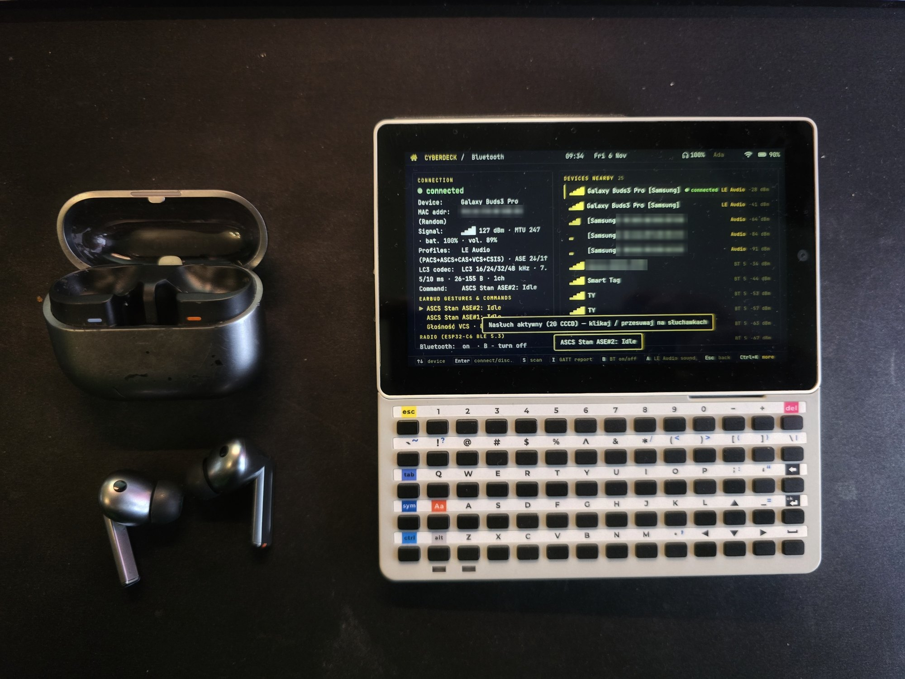
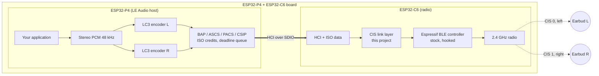

# Bluetooth LE Audio on ESP32-P4 + ESP32-C6

[](https://buymeacoffee.com/visual_form)


Stereo Bluetooth LE Audio from an ESP32-P4 + ESP32-C6 board (tested: M5Stack Tab5) to off-the-shelf LE Audio
earbuds.

Neither chip can do this out of the box: they have no Classic Bluetooth (so no A2DP), and the stock ESP32-C6
Bluetooth controller has no LE Isochronous Channels (so no LE Audio). This project adds a Connected Isochronous
Stream (CIS) link layer on top of Espressif's stock ESP32-C6 controller and an LE Audio host component for the
ESP32-P4 that drives it over HCI. This repository contains everything needed to build it into your own device.



*The Bluetooth screen of the cyberdeck firmware this project was extracted from, with both earbuds connected.*

## Features

- Stereo to both earbuds of a set: one CIS per earbud in a single CIG, left and right in sync.
- LC3 at 48 kHz, 96 kbit/s per channel. Home test: 15 minutes of stereo, 0.016 % / 0.07 % SDUs lost on air, no
  audible dropouts. Field test on a crowded train, with many other people on Bluetooth earbuds: no audible
  dropouts.
- Automatic reconnect: earbuds taken out of the case connect with their saved pairing, and the second earbud of the
  set joins on its own (CSIP).
- Earbud gestures: play / pause, next and previous track (Media Control).
- Pairing driven by your UI: scan, list the devices nearby, connect or pair the one the user picks.
- C6 firmware update from your P4 firmware over SDIO: no USB-UART adapter needed on boards like the Tab5.
- A ready-to-flash demo for the M5Stack Tab5: MP3 from the SD card, touch screen, device list, C6 installer.

## Quick test on an M5Stack Tab5

The demo player ([`examples/tab5_player`](examples/tab5_player)) plays MP3 files from the SD card to your earbuds.
You need LE Audio earbuds (tested: Samsung Galaxy Buds3 Pro; [reports for other models](#tested-earbuds) are
welcome), a microSD card (FAT32 or exFAT), a USB-C cable and Python with `esptool` (`pip install esptool`).

1. Copy your music into a folder named `music` at the root of the card and insert the card into the Tab5. Only
   MP3 files are played (any bitrate and sample rate, mono or stereo); other files are skipped. Subfolders are
   included, so whole albums can go in as they are. Tracks play in alphabetical order of their paths, in a loop.
2. Download `esp32p4-tab5_player-*.zip` from [Releases](../../releases), unzip it and flash the player over USB-C
   from the `esp32p4_tab5_player` folder. This replaces the firmware on the ESP32-P4.
   ```
   python -m esptool --chip esp32p4 -p <PORT> -b 460800 --before default_reset --after hard_reset write_flash "@flash_args"
   ```
3. On first start the player reports that the C6 has no LE Audio firmware. Tap **C6 firmware → Install**. It takes
   about 30 seconds, then the Tab5 restarts.
4. Put the earbuds into pairing mode (Galaxy Buds: both in the case, lid open, hold the touch pads until the LED
   pulses) and tap them in the list. Both earbuds play; next time they connect by themselves.

If something goes wrong, see [Flashing and recovery](docs/flashing-and-recovery.md). A C6 firmware that does not
work goes back to the previous one by itself.

## In your own firmware

You need an ESP32-P4 + ESP32-C6 board with the C6 on SDIO (tested: M5Stack Tab5), your own ESP-IDF project for the
P4, and Docker for the builds in this repository (ESP-IDF v5.5.5).

1. **C6 firmware.** Build it with `sh c6_firmware/build.sh` (must end with `RESULT: PASS`) or take
   `esp32c6-firmware-*.zip` from [Releases](../../releases).
2. **P4 side.** Add the [`p4_le_audio`](p4_le_audio) component and the patched esp_hosted host from
   [`components/`](components) to your project. [docs/integration.md](docs/integration.md) walks through the
   configuration and the bring-up order; [`p4_le_audio/test/compile_check`](p4_le_audio/test/compile_check) is the
   smallest firmware that uses the API, and the [Tab5 demo](examples/tab5_player) a complete one.
3. **Install the C6 firmware from your P4 firmware.** Link the image into your app and call
   `le_audio_c6_install()` after the user agrees: it is sent over SDIO with esp_hosted's OTA. Without such a
   firmware, the C6 can be flashed over its UART pads
   (`python -m esptool --chip esp32c6 -p <PORT> -b 460800 write_flash "@flash_args"`; on the Tab5: the 6-pin J1
   "C6_ISP" pads).

Working with an AI coding agent? Point it to [AGENTS.md](AGENTS.md): it tells the agent to check every step
against your project and adapt it, and what not to do with the C6.

## Known limitations

- The second earbud's CIS sometimes drops (disconnect reason 0x08) a few seconds after the stream starts, usually
  several times in a row right after connecting, while its ACL stays up. The host re-joins it automatically, with a
  gap of a few seconds; once it holds, it typically plays cleanly for 15 minutes and more. Under investigation.
- Joining the second earbud while a CIG is active often fails (0x3E). The host therefore stops the stream, joins
  the earbud and restarts in stereo.
- The microphone direction (earbud → P4) is not verified with NSE 2. No Broadcast (Auracast).
- Tested only on the M5Stack Tab5 (ESP32-C6 on SDIO).
- No Classic Bluetooth (A2DP) speakers: neither chip has a BR/EDR radio.

## How it works

Espressif's own LE Audio stack targets newer chips (ESP32-H4, ESP32-S31). The ESP32-C6 radio is fully capable of
isochronous traffic; what its controller lacks is the link-layer scheduling for it. This project provides that:

- **CIS link layer on the ESP32-C6.** The firmware hooks Espressif's closed BLE controller (`libble_app.a`) at link
  time and schedules CIS events on its connection state machines: two subevents per CIS (NSE 2), CCM encryption,
  flush timeout. It is exposed as standard HCI ISO commands and data.
- **Two CIS in one CIG.** Independent left and right streams, one per earbud, without any vendor earbud-to-earbud
  relay. The CSIP set coordinator finds the second earbud of the set by its RSI and SIRK.
- **LE Audio host on the ESP32-P4.** BAP unicast client (PACS, ASCS), CSIP, two LC3 encoders (liblc3), next to your
  application.
- **HCI over SDIO** (esp_hosted) with credit-based ISO flow control, a deadline queue that rides out SDIO stalls, and
  recovery of lost Number-Of-Completed-Packets events.



Details: [docs/architecture.md](docs/architecture.md), [docs/c6-link-layer.md](docs/c6-link-layer.md).

| | |
|---|---|
| Roles | BAP Unicast Client, CSIP Set Coordinator |
| Codec | LC3, 48 kHz, 10 ms frames, 120 octets per channel (96 kbit/s), presentation delay 40 ms |
| Topology | 1 CIG with 2 CIS; ISO interval 10 ms; NSE 2, BN 1, FT 4 |
| Host | ESP32-P4, dual-core RISC-V, 360 MHz |
| Radio | ESP32-C6, BLE 5.3; CIS link layer from this project on top of the stock controller |
| Transport | HCI over SDIO (esp_hosted), credit-based ISO flow control, 32 ISO buffers |
| Measured, home, 15 min stereo¹ | 0.016 % / 0.07 % SDUs lost on air, 0 host-side drops |

¹ Measured with the firmware this project was extracted from (same LE Audio host and CIS link layer). Full log:
[docs/measurements.md](docs/measurements.md).

### C6 safety net

A broken ESP32-C6 image is hard to fix without a cable, so the C6 firmware guards itself (`fw_guard`):

- An image installed by OTA runs on trial and confirms itself after 60 s of healthy operation: SDIO and BLE up, and
  the P4 talking to it. A P4 that turned Wi-Fi on must also have working Wi-Fi, since Wi-Fi may be its only way to
  update the C6 again; a BLE-only P4 firmware needs HCI traffic delivered in both directions.
- It rolls back to the previous image after 3 crashes, 10 boots, 600 s without confirmation, or an RTC watchdog
  reset.
- Two C6 crashes while a CIS is active disable the CIS layer until the next update; the C6 then runs as a plain BLE
  controller.
- The P4 can always reset the C6 (EN line) and power-cycle it.
- Last resort, only if an image breaks SDIO before the guard can act: the C6 UART pads (J1 "C6_ISP" on the Tab5)
  and a 3.3 V USB-UART adapter.

## Building and testing

Docker is the only requirement: all builds and tests run in the pinned `espressif/idf:v5.5.5` image. On Windows,
use Git Bash. None of these commands flash anything.

```
sh tools/fetch_deps.sh                       # liblc3 v1.1.3 and dr_libs at pinned commits -> third_party/
sh c6_firmware/build.sh                      # C6 firmware: host tests, build, hook check -> RESULT: PASS
sh p4_le_audio/test/compile_check/build.sh   # p4_le_audio built for the ESP32-P4 with the patched esp_hosted
sh examples/tab5_player/build.sh             # Tab5 demo with the C6 image embedded -> build/tab5_player.bin
```

Tests without hardware, in the same image
(`docker run --rm -v "$PWD:/src" -w /src --entrypoint bash espressif/idf:v5.5.5 -c "<command>"`):

```
sh cis_ll/test/run.sh             # CIS engine unit tests (ASan, UBSan)
sh cis_ll/sim/run.sh              # discrete-event simulator: reference peripheral, drift, host jitter, NSE 2
sh p4_le_audio/test/host/run.sh   # P4 models: HCI ISO, credits, PACS/ASCS, LC3, P4 <-> C6 HCI contract, CSIP, C6 image, SD split
python tools/privacy_scan.py      # no private data in the tree
```

| Path | Contents |
|---|---|
| [`cis_ll/`](cis_ll) | Portable CIS link-layer engine (C11), unit tests and simulator |
| [`c6_firmware/`](c6_firmware) | ESP32-C6 firmware: esp_hosted slave, CIS adapter on the stock controller, `fw_guard` |
| [`p4_le_audio/`](p4_le_audio) | ESP-IDF component: LE Audio host for the ESP32-P4, C API in `include/le_audio.h`, host tests, compile check |
| [`components/`](components) | esp_hosted 1.4.0 host with the patches the LE Audio host needs ([PATCHES.md](components/espressif__esp_hosted/PATCHES.md)); for the demo: fatfs with exFAT, Tab5 display stack |
| [`examples/tab5_player/`](examples/tab5_player) | Tab5 demo: MP3 from SD card, touch UI, device list, C6 installer |
| [`tools/`](tools) | C6 OTA client for a network endpoint, privacy scan, dependency fetch |
| [`docs/`](docs) | Integration guide, architecture, C6 link layer, flashing and recovery, measurements |

Using the P4 component:

```c
le_audio_config_t cfg = LE_AUDIO_CONFIG_DEFAULT();   // background reconnect and auto start
cfg.kv = my_bond_store;                               // bond storage (read-only store: nothing is written)
le_audio_init(&cfg);                                  // HCI over esp_hosted, checks the C6 supports CIS Central
le_audio_connect_bonded(5);                           // saved earbud; the second one joins by RSI/SIRK
le_audio_write_pcm(stereo48k, frames, 200);           // blocks until the LC3 queue has room (CIS is the clock)
le_audio_get_status(&st);                             // link, members, SDU / credit / queue counters
le_audio_c6_install(image, size, progress, NULL);     // C6 firmware over SDIO (after the user agrees)
```

## Status

- Builds and host tests pass; the component and the Tab5 demo build for the ESP32-P4.
- Verified on hardware (M5Stack Tab5, Galaxy Buds3 Pro), in the firmware this project was extracted from and in the
  Tab5 demo: stereo playback, device list, pairing never-paired earbuds, reconnecting saved ones, gestures.
- C6 firmware 1.4.85 installed from the P4 with `le_audio_c6_install()` in the Tab5 demo, over 1.4.84 and again over
  itself. `fw_guard` confirmed it with a Wi-Fi host (the firmware this project was extracted from) and with the
  BLE-only demo: 13 minutes of stereo past the 600 s trial limit, without a rollback.
- Not tested yet: installing over the M5Stack factory C6 firmware (our Tab5 already ran an earlier version of this
  firmware).

## Tested earbuds

| Device | Mode | Status | Notes |
|---|---|---|---|
| Samsung Galaxy Buds3 Pro | 2 × CIS, stereo | Working | L/R in sync, reconnect from saved keys, gestures |
| Your earbuds | unicast CIS | ? | [Open a test report](.github/ISSUE_TEMPLATE/earbud-report.md) |

## Background

I built this for my own cyberdeck on the M5Stack Tab5, as a hobby: I wanted my wireless earbuds to work with it.

The code was written with AI assistants. At the start, both models I worked with, one from Google and one from
Anthropic, said that audio over Bluetooth Low Energy on this chip was impossible. The hardware clearly had what it
takes, so I kept pushing and we kept looking for a way. The first workable ideas came out of that search, and step
by step they came together into what you see here.

All I needed was a cyberdeck that does what I want. I hope this project helps other hobbyists use their own
earbuds with their own devices.

## Contributing

Bug reports, earbud test reports and pull requests are welcome, especially for other earbud brands, other
P4 + C6 boards and HCI timing. See [CONTRIBUTING.md](CONTRIBUTING.md).

Contact: zapytania@formawizualna.pl <!-- privacy-scan: allow (public contact) -->

## Support

<a href="https://buymeacoffee.com/visual_form"></a>

The code is free under the MIT license, commercial use included, no strings attached. If it saved you time, a
coffee is appreciated; if it ships in your product, make it two.

## License

MIT for this project's code. Third-party components are listed in [NOTICE](NOTICE): ESP-IDF and the Espressif BLE
controller and PHY libraries (Apache-2.0), liblc3 (Apache-2.0), esp_hosted (Apache-2.0). The Espressif BLE
controller binary is not part of the source tree; it comes from ESP-IDF and is hooked at build time. The pre-built
C6 firmware in Releases contains it, as Apache-2.0 allows.

Bluetooth® is a registered trademark of Bluetooth SIG, Inc. Samsung and Galaxy Buds are trademarks of Samsung
Electronics. This project is not affiliated with or endorsed by either.
